<p align="center">
  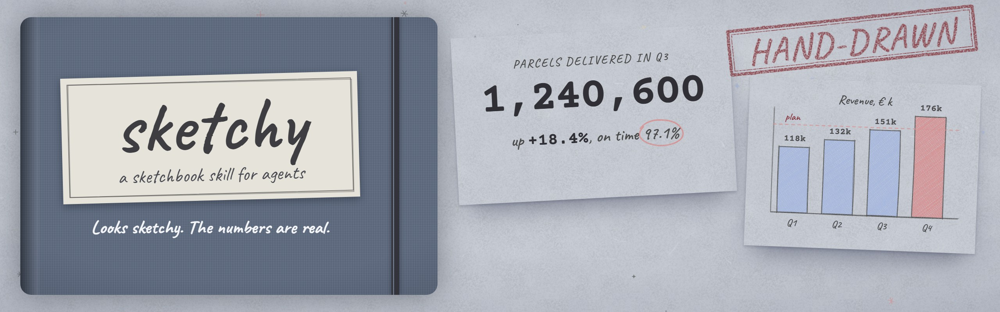
</p>

<h1 align="center">sketchy: hand-drawn slides, charts and explainers made by your AI agent</h1>

<p align="center"><b>Looks sketchy. The numbers are real.</b></p>

<p align="center">
  <a href="LICENSE"></a>
  <a href="INSTALL.md"></a>
  <a href="https://skills.sh/OthmanAdi/sketchy"></a>
  
</p>

sketchy is an agent skill for Claude Code, Codex, Cursor and Gemini CLI that makes hand-drawn slides, charts, lessons and explainer videos as one HTML file. The pages look like a pencil sketchbook, and the same look covers presentations, sketchnote-style lessons, one-page reports, whiteboard explainers, decision boards and postcards, with generative music for video. Every file opens offline and exports to PDF, PowerPoint (PPTX) and MP4. [See it live](https://othmanadi.github.io/sketchy/) · [read the skill](skills/sketchy/SKILL.md).

```bash
npx skills add OthmanAdi/sketchy
```

Other ways in: `/plugin install sketchy --marketplace OthmanAdi/sketchy` inside Claude Code, `npx sketchy-skill install` from npm (it copies the skill into every agent it finds on your machine), or `npx clawhub install sketchy` for OpenClaw.

Then ask in plain words: *"make a 10-slide board update from this spreadsheet"*, *"explain how DNS works for a class of 15-year-olds"*, *"turn these numbers into a one-pager for the CFO"*. Viewing needs a browser. Installing needs Node 18+. Checks and PDF, PPTX and PNG exports need Playwright; video needs FFmpeg. Other agents and the Claude Code plugin: [INSTALL.md](INSTALL.md).

<p align="center">
  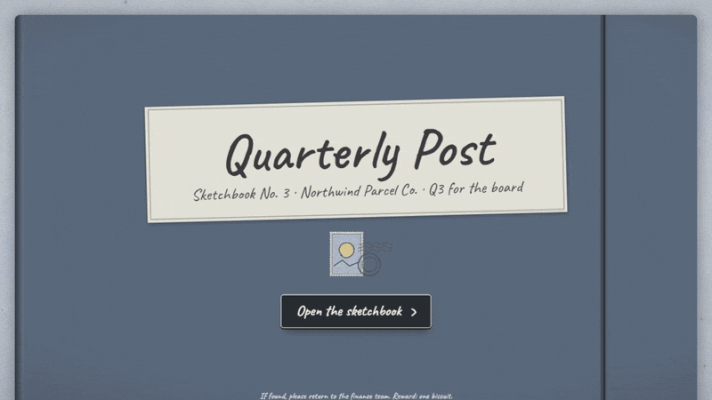
</p>

## Before and after: a default AI slide and a hand-drawn one

<p align="center">
  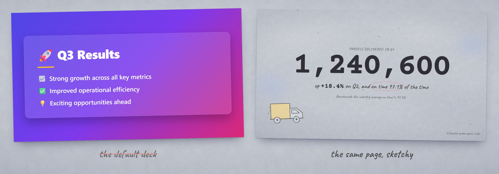
</p>

The default deck says *Q3 Results* and lists three bullets. A sketchy page says the point (*1,240,600 parcels, up 18.4%*), puts the benchmark next to it, rings the one number that matters in red pencil and draws the thing it is about. The lines wobble on purpose, and every figure is exact.

## What it makes: hand-drawn slides, charts, reports and videos

<table>
<tr>
<td width="50%"><a href="https://othmanadi.github.io/sketchy/examples/quarterly-post.html">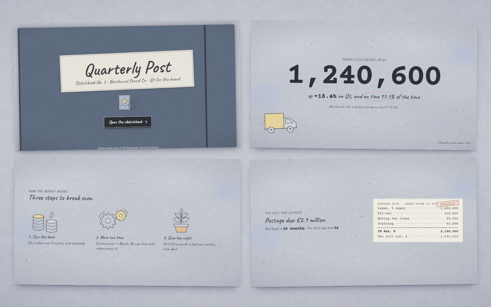</a><br><b>Board update deck</b> · 12 slides · cover, big number, plan versus record, the bill, a decision board</td>
<td width="50%"><a href="https://othmanadi.github.io/sketchy/examples/moon-lesson.html">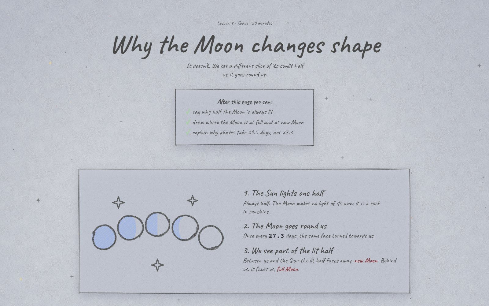</a><br><b>Lesson</b> · picture first, numbered steps, the math in the margin, a misconception crossed out</td>
</tr>
<tr>
<td><a href="https://othmanadi.github.io/sketchy/examples/q3-one-pager.html">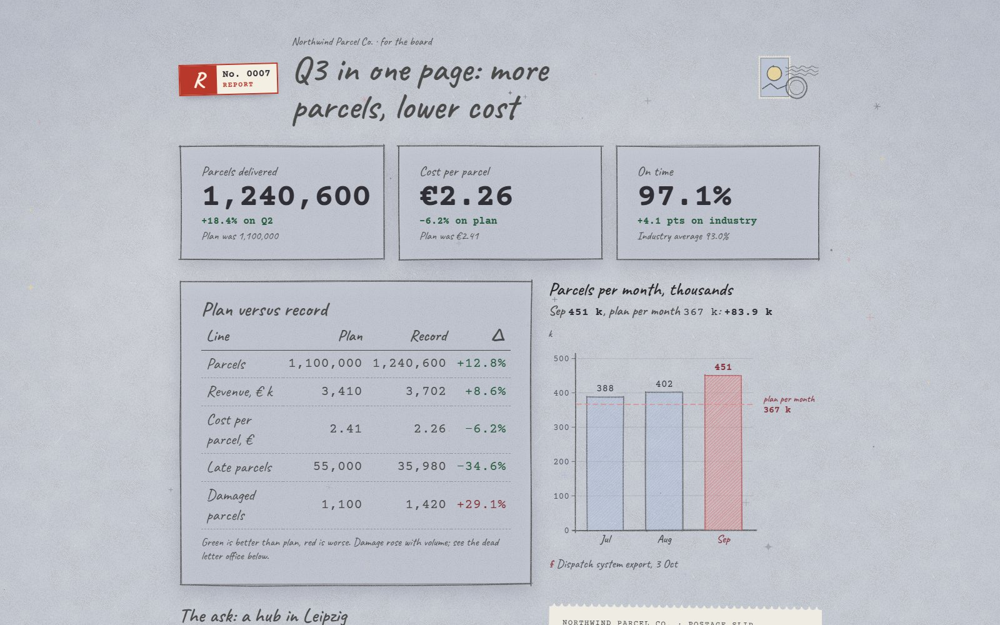</a><br><b>One-page report</b> · figures with benchmarks, plan versus record, a receipt for the ask, prints on A4</td>
<td><a href="https://othmanadi.github.io/sketchy/examples/cloud-ledger.html">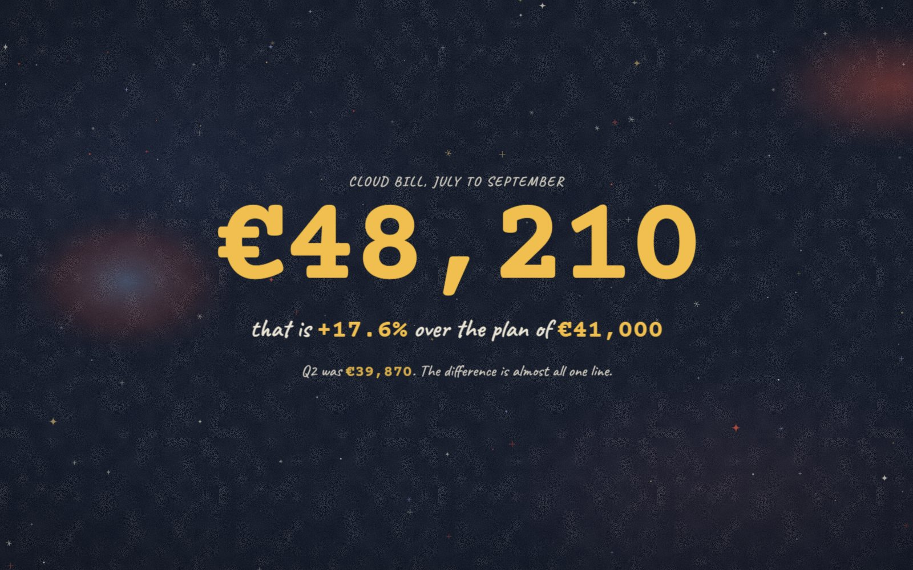</a><br><b>Night ledger deck</b> · chalk on night-blue paper, gold for what was paid, receipts that print line by line</td>
</tr>
<tr>
<td><a href="https://othmanadi.github.io/sketchy/examples/switch-board.html">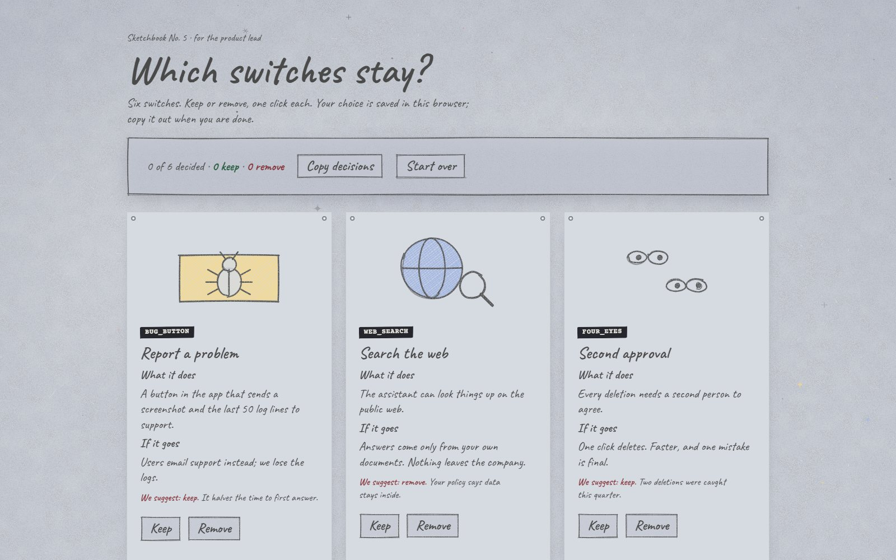</a><br><b>Decision board</b> · keep or remove, one click each, saved in the browser, copied out as text</td>
<td><a href="https://othmanadi.github.io/sketchy/examples/release-postcard.html">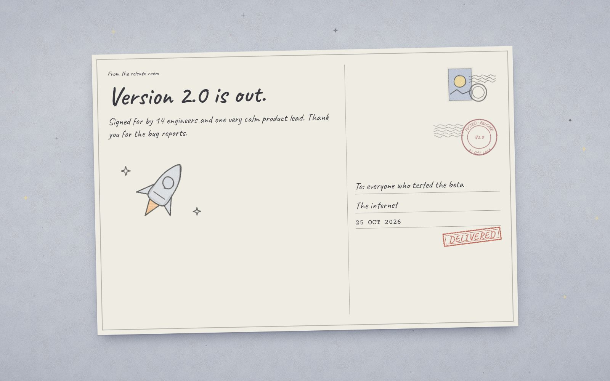</a><br><b>Postcard</b> · release notes, thank-yous and certificates as a 1200 × 800 card</td>
</tr>
</table>

The examples use invented figures for a fictional company. Click any picture to open the live page (the built files are also in [`docs/examples/`](docs/examples/)); in a deck press `o` for the overview and `s` for sound.

## Made by an agent, unedited

We gave Claude Sonnet the skill and three requests, worded the way people type them. These are its first results, untouched.

<p align="center">
  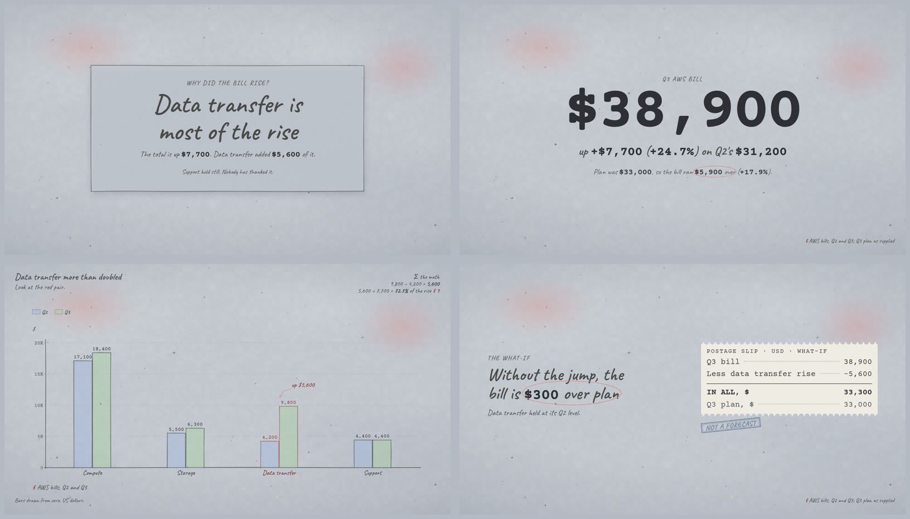
</p>

<p align="center"><sub><i>"My CFO wants a short deck tomorrow morning about why our AWS bill went from $31,200 in Q2 to $38,900 in Q3 … 6 to 8 slides … and a PDF too."</i> 7 slides and a 7-page PDF. It said the bill rose, said where, and said it could not know why.</sub></p>

<table>
<tr>
<td width="50%">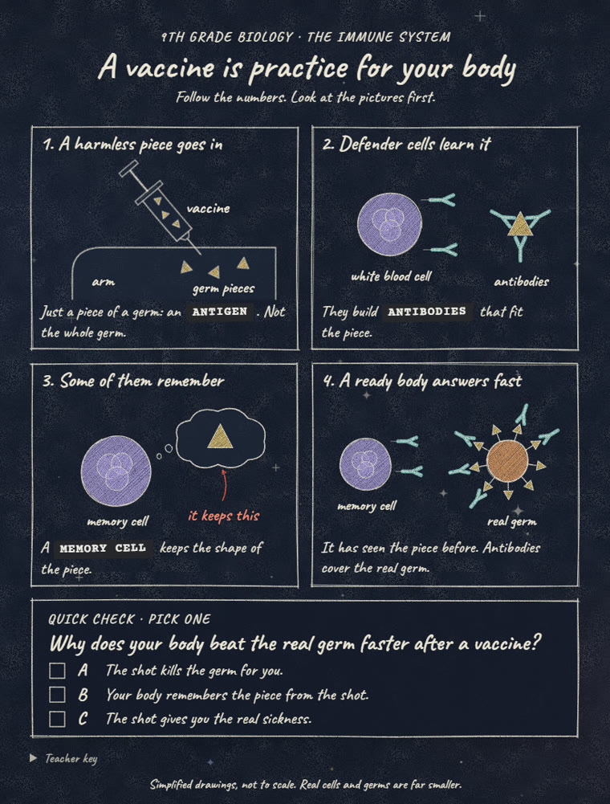<br><sub><i>"I teach 9th grade biology … how vaccines train the immune system, for students who struggle with reading."</i> 156 words, four pictures, and a quiz whose wrong answers are the two common misconceptions.</sub></td>
<td width="50%">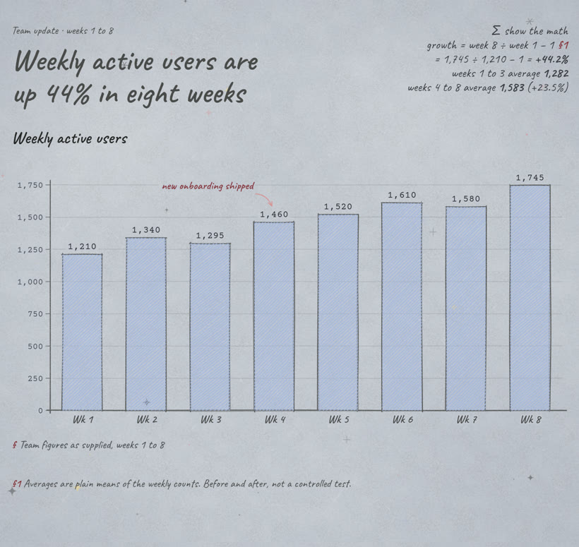<br><sub><i>"here's our weekly active users for the last 8 weeks … we shipped the new onboarding in week 4."</i> The note sits on week 4, the math is in the margin, and the footnote says it is not a controlled test.</sub></td>
</tr>
</table>

Together the three runs passed 20 of 21 checks: exact figures, a benchmark beside the total, lint clean, PDF page count, the chart's hidden data table. The one miss was the lesson: the catalog had no biology pictures, so the agent drew its own. A health and life science set has been added since. The prompts and checks are in [`skills/sketchy/evals/evals.json`](skills/sketchy/evals/evals.json).

## Ask for it like this

| You say | sketchy builds | Exports |
|---|---|---|
| `sketchy deck` or "make slides about…" | a deck on a 1920 × 1080 stage with page turns, step reveals and speaker notes | HTML, PDF, PPTX, MP4 |
| `sketchy explain` or "teach / explain…" | a lesson page or a lesson deck | HTML, PDF |
| `sketchy report` or "one-pager / memo…" | a printable one-page report with figures, benchmarks and a chart | HTML, PDF |
| `sketchy chart` or "chart this…" | hand-drawn charts with exact values in a hidden table | HTML, PNG, PDF |
| `sketchy board` or "help them decide…" | a keep-or-remove decision board | HTML |
| `sketchy postcard` | a share card, thank-you or certificate | HTML, PNG |
| `sketchy video` | any deck as an MP4 with a generated soundtrack | MP4 |
| `sketchy audit <file>` | a lint and review report, no edits | text |
| `sketchy theme` | a theme from your brand color | CSS |

## How a build runs

1. **Brief.** Audience, the one sentence they must remember, what they decide afterwards, which numbers exist and where they come from.
2. **Deal a style.** `deal.mjs` picks paper, cover, pencils, a motif and the opening page, and avoids your recent draws, so ten decks do not look like one.
3. **Storyboard in text.** One point per page, a picture or a number for each, before any HTML.
4. **Draw.** The agent fills a template with engine classes. Charts are specs, pictures come from a catalog of more than 100 sketches.
5. **Check by looking.** `lint.mjs` catches overflow, collisions, tiny type, weak contrast, wordy slides, placeholder text and network requests. `shoot.mjs` screenshots every page and the agent reads them. A fresh reviewer agent, which never sees the code, scores the pages and lists fixes.
6. **Subtract, export, deliver.** One protagonist per page, then PDF, PPTX or MP4.


## The look, in rules

- **Paper is a material.** Seeded grain, fibers, a blue-black vignette and a sky of colored-pencil specks. Never a flat cream page.
- **One graphite pencil, one red pencil.** Red marks the single thing to look at. Pastel pencils carry the data.
- **Dashed is the plan, solid is the record.** At night, gold is the record (what was paid, measured or computed) and blue is the benchmark.
- **Handwriting for people, typewriter for the record.** Caveat for words, Courier Prime for every number.
- **Lines boil.** Every drawing exists in four variants swapped ten times a second, the shimmer of hand-drawn animation. Two frames a second with reduced motion.
- **Paper motion.** Sheets settle with a 10 px drop and a small tilt, pages turn on their spine, stamps slam once, receipts print line by line, totals count up.

The full style in exact values is in [style-dna.md](skills/sketchy/references/style-dna.md).

## Sound and music

Sound stays off until the viewer presses `s` or the sound button. Everything you hear is synthesized in the browser with Web Audio, without samples, an API key or a network connection.

- **Effects:** pencil scratch on a step, page turn, rubber stamp, paper slide, bells tuned to the music's key.
- **Music:** generative, in moods (`sketchbook`, `ledger`, `focus`, `calm`). Chords come from a Markov chain, melodies from constrained walks on the scale, and the same deck seed always gives the same piece.
- **Video:** `render-video.mjs` renders that same soundtrack offline, mixes in the effects at each page turn and stamp, and masters it to -16 LUFS.

## Themes and your own templates

Six papers ship: `day` sketchbook (default), `night` ledger, `kraft`, `blueprint`, `graph` and `cartridge`. A theme is a file of color tokens; nothing else changes. Put your own in `./.sketchy/themes/` for one project or `~/.sketchy/themes/` for all your work, and your own templates in the matching `templates/` folder. sketchy looks there before its built-ins. Start from [`themes/_starter.css`](skills/sketchy/themes/_starter.css).

## Limits

- The handwriting font covers Latin and Cyrillic. Arabic, Hebrew, Greek and CJK fall back to the system's handwriting face; the agent says so and checks the screenshots.
- PPTX cannot carry a handwriting font or boiling lines. `faithful` mode bakes each slide as a picture with notes and hidden text; `editable` mode puts real text boxes in a safe font over the drawn art.
- sketchy does not draw live data, photographs or 3D scenes.

## FAQ

**Do I need an API key or an account?** Only what your agent already uses. sketchy itself calls no service; the pages, the sound and the exports run on your machine.

**Can I edit the result by hand?** Yes. It is plain HTML with readable classes. Change a word, reload.

**Will my numbers survive?** The agent is told never to invent figures, to print sources, benchmarks and units, and to start bars at zero. Charts keep the exact values in a hidden table next to the drawing, and the linter checks that the table is there.

**Is it accessible?** Text stays real text, contrast is linted, every chart has a data table, decks work from the keyboard, and reduced motion is respected.

**Is it an Excalidraw or rough.js alternative?** It is not built on either. A seeded pencil engine with no dependencies draws every page, and the agent writes the whole document around it: layout, words, numbers, sound.

**Can it make an editable PowerPoint?** Yes. `export-pptx.mjs --mode editable` puts real text boxes over the drawn art (in a standard font, since PowerPoint cannot carry the handwriting). `--mode faithful` keeps the look exactly, as pictures with your speaker notes.

**Can it match my brand?** Give the agent your color or an existing slide. It makes a theme from it and keeps the pencil look.

## Update and remove

```bash
npx skills update            # update every installed skill, sketchy included
npx skills remove sketchy    # remove it
```

Plugin installs, Codex and Gemini CLI have their own update and remove commands in [INSTALL.md](INSTALL.md).

## Contributing

New sketches, chart types, themes and templates are welcome. Read [CONTRIBUTING.md](CONTRIBUTING.md); every visual change comes with a screenshot, and the checker and the linter must pass.

## License

[MIT](LICENSE) © 2026 Ahmad Othman Ammar Adi

<p align="center"><sub>If found, please return to the repository. Reward: a star.</sub></p>
